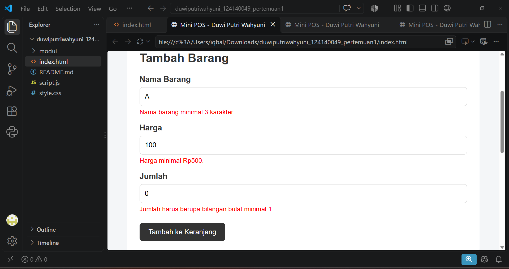
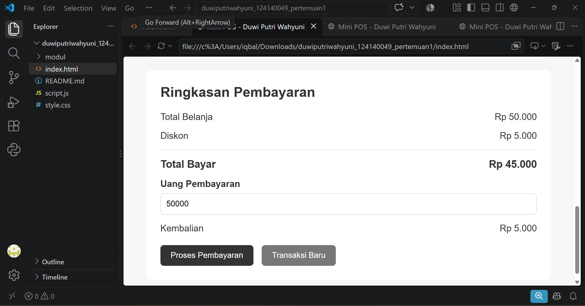

# Mini POS - Pertemuan 1

## Identitas

Nama Lengkap: Duwi Putri Wahyuni  
NIM: 124140049  
Kelas Praktikum: RA  

## Deskripsi Aplikasi

Mini POS adalah aplikasi kasir dan keranjang belanja sederhana
untuk membantu proses transaksi pada kantin atau toko kampus.

Aplikasi dapat menambahkan barang ke keranjang, menghitung subtotal,
total belanja, diskon, total pembayaran, dan kembalian.

## Cara Menjalankan

1. Buka folder project menggunakan Visual Studio Code.
2. Buka file index.html.
3. Jalankan menggunakan browser atau Live Server.
4. Aplikasi Mini POS siap digunakan.

## Fitur

- [x] Validasi nama barang
- [x] Validasi harga
- [x] Validasi jumlah barang
- [x] Tambah barang ke keranjang
- [x] Menghitung subtotal
- [x] Menghitung total belanja
- [x] Perhitungan diskon
- [x] Perhitungan pembayaran
- [x] Perhitungan kembalian
- [x] Menghapus barang
- [x] LocalStorage
- [x] Transaksi baru

## Screenshot

### 1. Tampilan Form Input

### 2. Validasi Input

### 3. Hasil Perhitungan

## Penjelasan Teknis

Validasi input dilakukan menggunakan JavaScript untuk memastikan
nama barang minimal 3 karakter, harga minimal Rp500, dan jumlah
berupa bilangan bulat minimal 1.

Subtotal dihitung menggunakan rumus:

Subtotal = Harga × Jumlah

Jika total belanja mencapai Rp50.000 atau lebih, sistem memberikan
diskon sebesar 10%.

Total bayar dihitung dengan:

Total Bayar = Total Belanja - Diskon

Kembalian dihitung dengan:

Kembalian = Uang Bayar - Total Bayar

Data keranjang disimpan menggunakan localStorage sehingga data
tetap tersedia ketika halaman di-refresh.

## Teknologi

- HTML
- CSS
- JavaScript
- LocalStorage